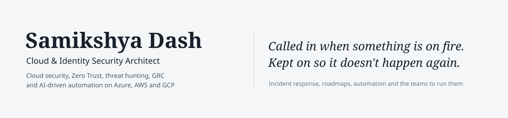

<picture>
  <source media="(prefers-color-scheme: dark)" srcset="banner-dark.svg">
  
</picture>

Hi, I'm Samikshya. I've been in tech for nine years, and in cloud and identity security for the last six.

A lot of my work starts with a problem that can't wait. A payment page under attack. A migration with a go-live date that won't move. An audit two weeks away. I deal with the immediate issue first, then look at why it happened and fix that properly. Sometimes that's a roadmap, sometimes an automation, sometimes a change in how the team works.

### What I work on

- Cloud security on Azure, AWS and GCP: posture management, cleaning up excess permissions, landing zones and guardrails
- Identity for employees (Entra ID, Active Directory), for customers (Azure AD B2C, AWS Cognito), for cloud workloads (AWS and GCP IAM), and for the service accounts and AI agents most teams have lost track of
- Threat hunting and detection tuning in Microsoft Sentinel and Defender XDR, and incident response when things go wrong
- Zero Trust assessments and roadmaps, security controls, audit readiness, and AI governance against NIST AI RMF and ISO 42001
- Automating repetitive security work, more and more of it with AI agents
- Roadmaps and business cases for CISOs, pre-sales, and leading the teams that deliver

### Things I've built

- **[agent-identity-posture](https://github.com/samikshya-dash/agent-identity-posture)** scans Entra ID and AWS IAM for risky service accounts, keys and AI agents, and shows how a normal user or agent could end up with admin access.
- **[identity-protection-triage-agent](https://github.com/samikshya-dash/identity-protection-triage-agent)** is an AI agent that works through Entra ID Protection alerts, closes the ones already dealt with and investigates the rest.
- **[ai-agent-red-team-playbook](https://github.com/samikshya-dash/ai-agent-red-team-playbook)** is a step-by-step method for testing AI agents before attackers do.
- **[identity-security-automation](https://github.com/samikshya-dash/identity-security-automation)** has five automations from real identity work, rebuilt so they can be shared.

All of these use made-up data. Nothing from client work is in here.

### Tech I use

**Platforms:** Azure, AWS, Google Cloud, Entra ID, Active Directory, Azure AD B2C, AWS Cognito, AWS IAM, GCP IAM, Microsoft Sentinel, Defender XDR, Defender for Identity, Defender for Cloud Apps, Prisma Cloud, Azure WAF and Front Door, Microsoft Purview, ServiceNow

**Tools:** Python, KQL, Microsoft Graph API, Terraform, CloudFormation, GitHub Actions, Logic Apps, Copilot Studio, Security Copilot, n8n, Splunk

### Certifications

Azure Solutions Architect Expert (AZ-305), Cybersecurity Architect Expert (SC-100), Identity and Access Administrator (SC-300), Azure Security Engineer (AZ-500), Azure Administrator (AZ-104), Microsoft 365 Administrator (MS-102)

### Say hello

The easiest way to reach me is on [LinkedIn](https://www.linkedin.com/in/samikshya-dash-cybersecurity).
